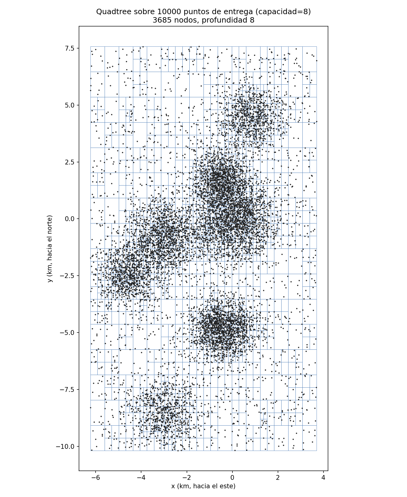
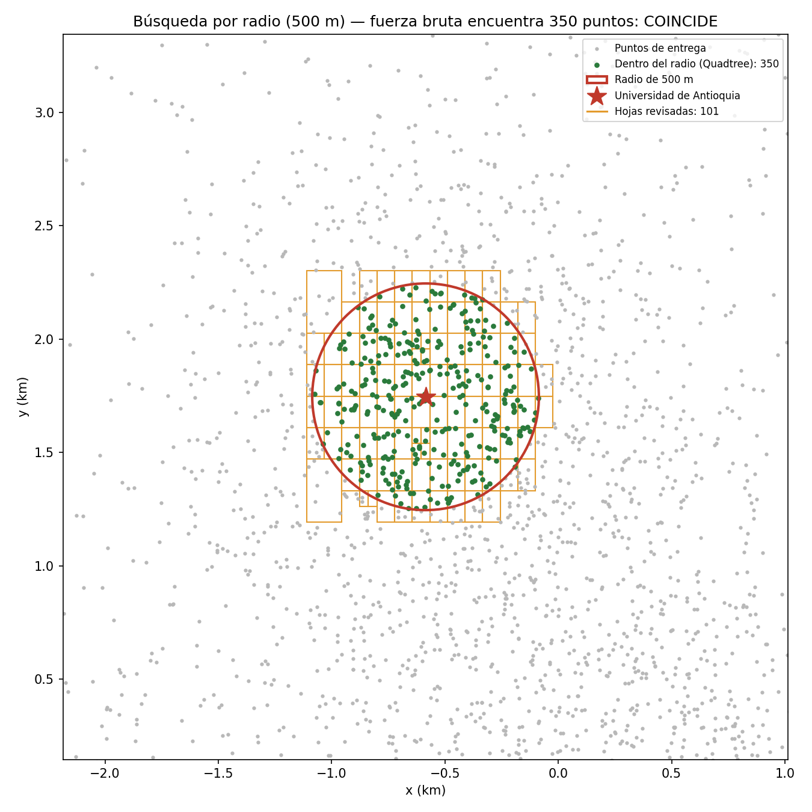
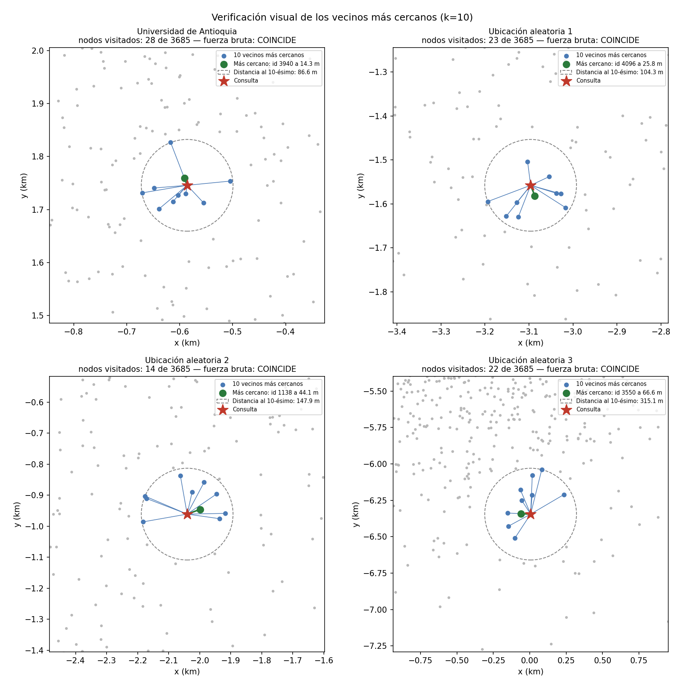
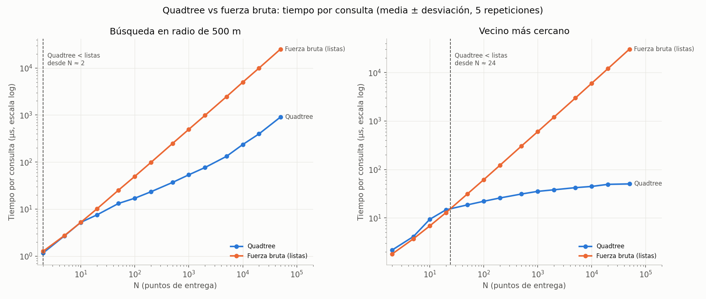

# Laboratorio 4: Sistema de Logística de Entregas con Quadtree
**Autor:** Marino Gómez

Implementación desde cero de un **Quadtree generalizado a K dimensiones** (2D → 4 hijos por nodo, 3D → 8 "octree", K → 2^K) para responder, sobre 10.000 puntos de entrega estáticos:

* ¿Qué puntos de entrega están a un radio de **500 metros** de un punto dado? (*Range Search*)
* ¿Cuál es el punto de entrega **más cercano** (o los *k* más cercanos) a una ubicación dada?

Los resultados se comparan contra **fuerza bruta con listas**. No se usan árboles de librerías (ni `scipy`, ni `sklearn`).

## Estructura del repositorio

| Archivo | Contenido |
|---|---|
| `Quadtreetree.py` | `Caja`, `Nodo`, `Quadtree` (inserción, búsqueda por radio, k vecinos más cercanos), `FuerzaBruta`, conversión de unidades y generación/carga de los datos |
| `test.py` | 25 pruebas unitarias (2D, 1D, 3D, 4D, 5D, unidades, casos borde) + verificación visual |
| `analisis.py` | Métricas de rendimiento, gráficas y discusión de resultados |
| `datos/puntos_entrega.csv` | Los 10.000 puntos de entrega (id, lat, lon, x_m, y_m) |
| `graficas/` | Todas las gráficas generadas |

## Datos y unidades

Los puntos se generan una sola vez (semilla fija) y se guardan en `datos/puntos_entrega.csv`, por lo que son estáticos. Simulan coordenadas GPS de Medellín: 80 % concentrados en zonas de alta demanda (Centro, El Poblado, Laureles, Aranjuez, Belén, Manrique, Envigado) y 20 % uniformes en el valle.

**Unidades:** latitud/longitud están en grados, y un grado de longitud no mide lo mismo que uno de latitud, así que un radio "en grados" no tiene sentido. Cada punto se proyecta a un plano local en **metros** (proyección equirectangular centrada en el Parque Berrío: `x` hacia el este, `y` hacia el norte). El árbol trabaja en metros, de modo que la consulta "a 500 m" es literalmente `radio = 500`. Para el tamaño de una ciudad (~20 km) el error frente a la distancia geodésica es despreciable. Ver `latlon_a_metros` / `metros_a_latlon`.

## Diseño del Quadtree K-dimensional

* **Caja:** esquina mínima y esquina máxima, con una coordenada por dimensión. `subdividir` la parte por el centro en todas las dimensiones; cada dimensión duplica las cajas (2D → 4, 3D → 8, K → 2^K).
* **Nodo:** las hojas guardan hasta `capacidad` puntos (8). Al pasarse, la hoja se parte y sus puntos se vuelven a insertar, así que cada uno baja al hijo cuya caja lo contiene.
* **Puntos repetidos:** `profundidad_maxima` evita partir sin fin.
* **Búsqueda por radio (recursiva):** se revisan los puntos de las hojas y solo se entra a los hijos cuya caja está a `radio` o menos de la consulta (`distancia_minima`). Esa es la **poda**: una caja más lejana se descarta entera.
* **k vecinos más cercanos (recursiva):** se guardan los *k* mejores en una lista ordenada. En cada nodo se visitan primero los hijos más cercanos, y apenas un hijo queda más lejos que el peor de los *k*, se dejan de revisar los siguientes.
* Árbol y fuerza bruta usan la misma función `distancia` (la fórmula euclidiana escrita a mano), para que la comparación sea justa.

## Ejecución

```bash
pip install matplotlib
python Quadtreetree.py   # demo: puntos a 500 m de la UdeA y el más cercano
python test.py           # pruebas unitarias + gráficas de verificación visual
python analisis.py       # métricas, gráficas de rendimiento y discusión (~30 s)
```

## Verificación visual

**Estructura del árbol** sobre los 10.000 puntos: las celdas se subdividen más en las zonas densas.



**Búsqueda en radio de 500 m** desde la Universidad de Antioquia: 350 puntos encontrados, idénticos a fuerza bruta. En naranja, las únicas hojas que el árbol tuvo que revisar.



**Vecinos más cercanos (k = 10)** para cuatro ubicaciones: en verde el más cercano, en azul los demás; el círculo punteado llega al 10.º vecino. El árbol visita entre 14 y 28 de sus 3.685 nodos y coincide con fuerza bruta.



## Análisis comparativo

Tiempo **por consulta** (media ± desviación estándar de 5 repeticiones). Las ubicaciones consultadas siguen la misma distribución de demanda que los puntos. El área de la ciudad es fija, así que al crecer N crece la densidad.



| N | QT radio | Listas radio | QT vecino | Listas vecino |
|---:|---:|---:|---:|---:|
| 10 | 5.2 µs | 5.2 µs | 9.3 µs | 6.8 µs |
| 100 | 17.0 µs | 49.7 µs | 22.0 µs | 61.5 µs |
| 1.000 | 53.6 µs | 496 µs | 35.3 µs | 603 µs |
| **10.000** | **236 µs** | **5.000 µs** | **44.7 µs** | **6.022 µs** |
| 50.000 | 909 µs | 25.263 µs | 50.4 µs | 30.467 µs |

*(Los valores exactos varían un poco entre ejecuciones; `analisis.py` imprime la tabla completa).*

### ¿Para qué tamaño de datos el Quadtree comienza a ser más rápido que fuerza bruta?

* **Vecino más cercano: desde N ≈ 24 (entre 20 y 50 puntos).** Con N ≤ 8 (la capacidad) el árbol es una sola hoja: hace el mismo recorrido lineal que la lista y además paga el costo de recorrer el árbol, así que es un poco más lento. Con pocos niveles ese costo todavía pesa. En cuanto el árbol crece, la poda gana y la diferencia aumenta rápido: con 10.000 puntos el árbol es **~135x más rápido**, y su tiempo casi no aumenta con N (≈ O(log N)), mientras que la lista crece linealmente.
* **Búsqueda en radio: prácticamente desde el inicio (N ≈ 2–10).** Con N muy pequeño la ventaja viene de una sola comprobación contra la caja raíz, que descarta las consultas lejanas a todos los puntos. Son diferencias de ~1 µs, del orden del ruido de medición. Con 10.000 puntos el árbol es **~21x más rápido**. La ventaja es menor que en el vecino más cercano porque el árbol debe recorrer igual los ~130 puntos que caen dentro de los 500 m: el costo es O(log N + m), con m = puntos encontrados.

En la práctica, para cualquier volumen realista de entregas (cientos o más), el Quadtree es claramente superior.

## Conclusiones

1. El Quadtree responde correctamente ambas preguntas, y las 25 pruebas lo verifican contra fuerza bruta en 1D, 2D, 3D, 4D y 5D.
2. Frente a listas, el árbol es más rápido desde tamaños muy pequeños (N ≈ 24 para vecino más cercano), y la ventaja crece con N: con los 10.000 puntos del enunciado es ~21x más rápido en radio y ~135x en vecino más cercano.

---

## Declaración sobre el uso de Inteligencia Artificial (IA)

Para el desarrollo de esta práctica de laboratorio, se utilizó Inteligencia Artificial (IA) como herramienta de asistencia o "copiloto" de programación para agilizar la escritura del código fuente, la estructuración de la sintaxis en Python y el formato de esta documentación. 

Es importante destacar que **el diseño del algoritmo, la lógica estructural y el control del experimento fueron dirigidos e inspeccionados estrictamente por mi persona en todo momento.** Las decisiones arquitectónicas, la validación de los requisitos y la implementación fueron analizadas y aprobadas manualmente para garantizar que la solución cumpliera con los objetivos exactos del laboratorio. La IA operó únicamente como un facilitador bajo mi supervisión directa.
